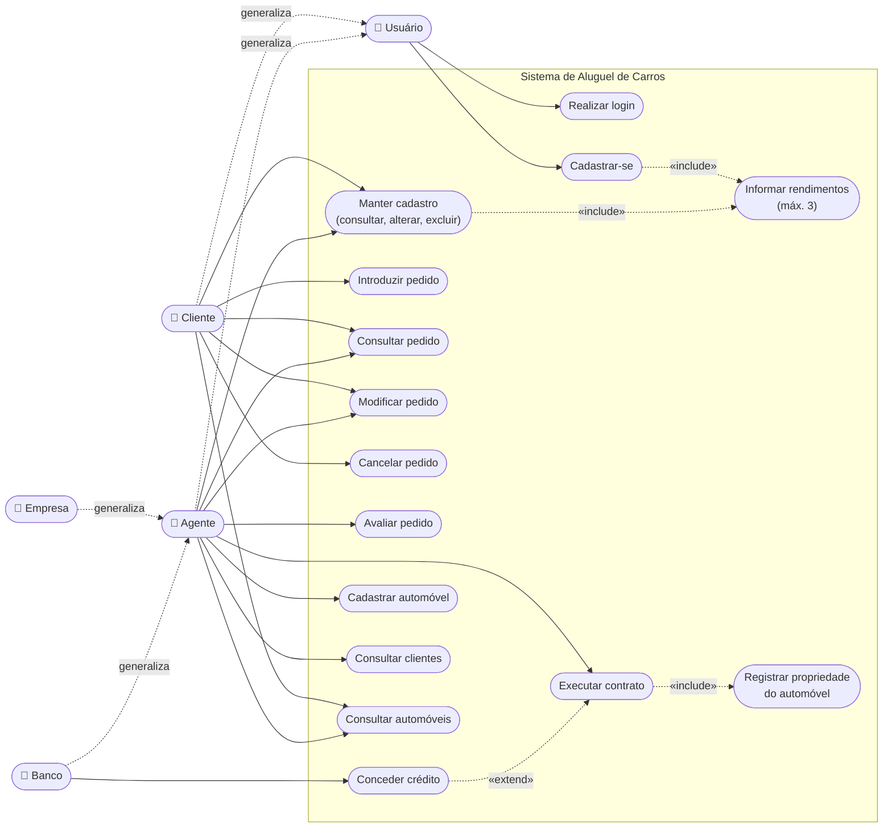

# Diagrama de Casos de Uso

Fonte PlantUML: [`casos-de-uso.puml`](./casos-de-uso.puml). A versão abaixo é uma aproximação em Mermaid (flowchart) para visualização direta no GitHub.

## Atores

| Ator | Descrição |
| :--- | :--- |
| **Usuário** | Pessoa que acessa o sistema; pode se cadastrar como cliente e realizar login. |
| **Cliente** | Pessoa física que introduz, modifica, consulta e cancela pedidos de aluguel. |
| **Agente** | Generalização de Empresa e Banco; modifica e avalia pedidos e executa contratos. |
| **Empresa** | Agente do tipo `EMPRESA` (locadora). |
| **Banco** | Agente do tipo `BANCO`; além das ações de agente, concede contratos de crédito. |

## Casos de uso

| Caso de uso | Atores | Histórias | Implementação (API / tela) |
| :--- | :--- | :--- | :--- |
| UC01 Realizar login | Usuário (Cliente, Agente) | US02 | `GET /api/auth/me` / Login |
| UC02 Cadastrar-se | Usuário | US01 | `POST /api/clientes` / Cadastro |
| UC03 Manter cadastro (consultar, alterar, excluir) | Cliente (próprio), Agente | US03, US04, US05 | `GET`/`PUT`/`DELETE /api/clientes/{id}` / Meu perfil (cliente) e Clientes (agente) |
| UC04 Informar rendimentos (máx. 3) | Usuário, Cliente (incluído em UC02 e UC03) | US06 | campo `rendimentos` de `POST`/`PUT /api/clientes` / ClienteForm |
| UC05 Introduzir pedido | Cliente | US08 | `POST /api/pedidos` / Pedidos |
| UC06 Consultar pedido | Cliente, Agente | US09, US17 | `GET /api/pedidos`, `GET /api/pedidos/{id}`, `GET /api/pedidos/{id}/contrato` / Pedidos |
| UC07 Modificar pedido | Cliente (`PENDENTE`), Agente (`PENDENTE`/`APROVADO`) | US10, US12 | `PUT /api/pedidos/{id}` / Pedidos |
| UC08 Cancelar pedido | Cliente | US11 | `PATCH /api/pedidos/{id}/cancelar` / Pedidos |
| UC09 Avaliar pedido | Agente | US13 | `PATCH /api/pedidos/{id}/avaliar` / Pedidos |
| UC10 Executar contrato | Agente | US14 | `POST /api/pedidos/{id}/contrato` / Pedidos |
| UC11 Registrar propriedade do automóvel | Agente (incluído em UC10) | US16 | campo `tipoProprietario` do contrato |
| UC12 Conceder crédito | Banco (estende UC10) | US15 | campos `credito`, `valorCredito`, `taxaJuros`, `parcelas` do contrato |
| UC13 Cadastrar automóvel | Agente | US18 | `POST /api/automoveis` / Automóveis |
| UC14 Consultar clientes | Agente | US07 | `GET /api/clientes` / Clientes |
| UC15 Consultar automóveis | Cliente, Agente | US19 | `GET /api/automoveis` / Automóveis |

Todos os casos de uso estão implementados no back-end e no front-end. Alteração e exclusão de automóveis não fazem parte do escopo do protótipo: os métodos existem em `AutomovelService`, mas não há endpoint nem tela para eles.

As histórias completas estão em [`../historias-de-usuario.md`](../historias-de-usuario.md).
