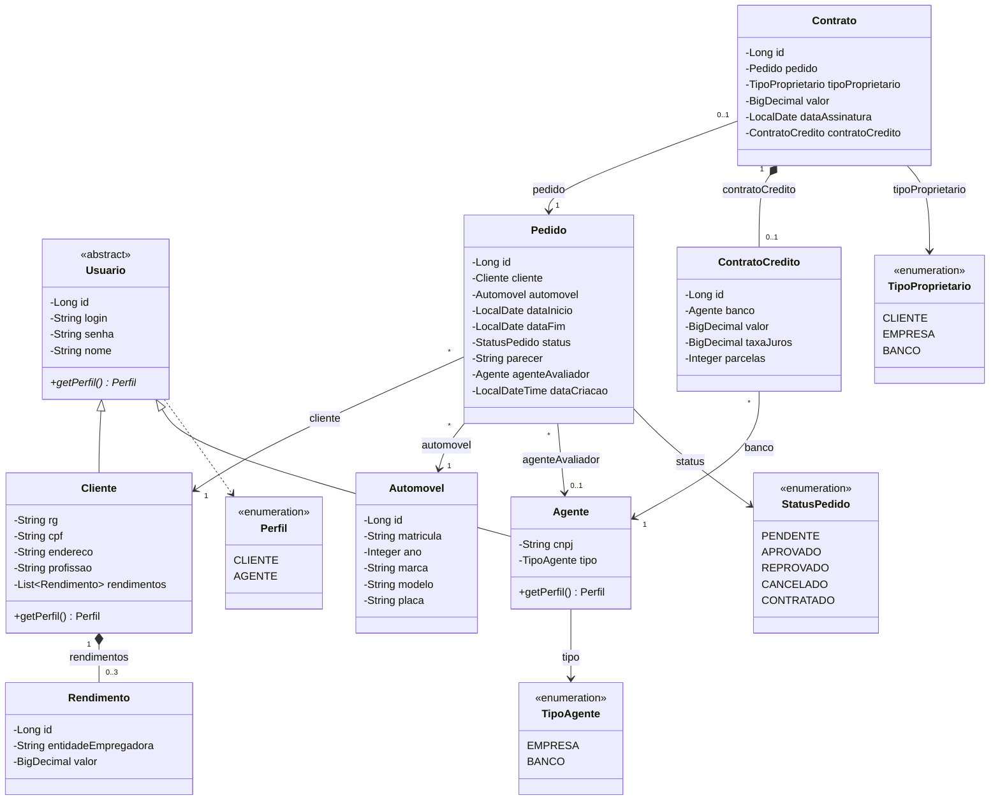
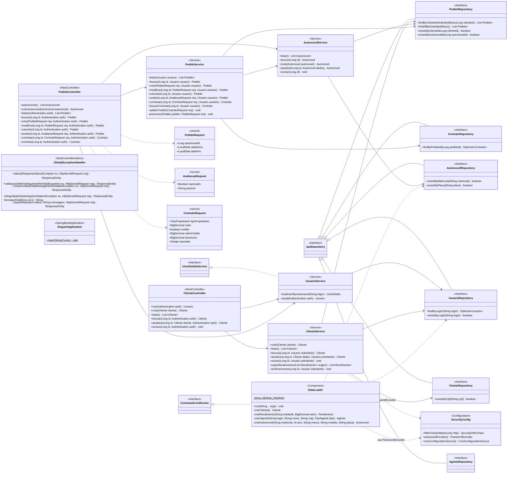

# Diagrama de Classes

Fonte PlantUML: [`classes.puml`](./classes.puml) (contém dois diagramas: `classes`, com o modelo de domínio, e `classes-camadas`, com as camadas MVC). As versões abaixo usam Mermaid para visualização direta no GitHub e refletem exatamente o código em `backend/src/main/java/br/pucminas/aluguel`.

## 1. Modelo de domínio (`model`)

### Regras e restrições do modelo

| Elemento | Detalhe |
| :--- | :--- |
| `Usuario` | Classe abstrata com herança JPA `JOINED` (tabelas `usuario`, `cliente`, `agente`). `login` é único; `senha` é gravada com BCrypt e é somente escrita no JSON (`WRITE_ONLY`). |
| `Cliente.rendimentos` | `@OneToMany` unidirecional (coluna `cliente_id` em `rendimento`), `EAGER`, `cascade = ALL`, `orphanRemoval`, limitado a **3** itens (`@Size(max = 3)`). |
| `Cliente.cpf` / `Agente.cnpj` | Únicos. |
| `Automovel.matricula` / `Automovel.placa` | Únicos e obrigatórios. |
| `Pedido.status` | Inicia em `PENDENTE`; `dataCriacao` recebe `LocalDateTime.now()`. |
| `Contrato.pedido` | `@OneToOne(optional = false)`: cada pedido tem no máximo um contrato. `dataAssinatura` recebe `LocalDate.now()`. |
| `Contrato.tipoProprietario` | Define se o automóvel fica registrado como propriedade do `CLIENTE`, da `EMPRESA` ou do `BANCO`. |
| `Contrato.contratoCredito` | `@OneToOne(cascade = ALL)`, opcional; concedido apenas por `Agente` com `tipo = BANCO`. |

## 2. Camadas MVC (`controller`, `service`, `repository`, `dto`, `config`)

Observações sobre as camadas:

- Os repositórios estendem `JpaRepository<T, ID>` com `ID = Long` e `T` igual à entidade correspondente (`Usuario`, `Cliente`, `Agente`, `Automovel`, `Pedido`, `Contrato`).
- Os métodos do `GlobalExceptionHandler` retornam `ResponseEntity<Map<String, Object>>`, com o corpo `{timestamp, status, error, message, path}`; no Mermaid o tipo aparece simplificado como `ResponseEntity`.
- `ClienteService` e `DataLoader` recebem o `PasswordEncoder` (BCrypt) declarado como `@Bean` em `SecurityConfig`.
- `AutomovelService.atualizar()` e `AutomovelService.excluir()` existem na camada de serviço, mas não são expostos por endpoint REST: a API oferece apenas `GET` e `POST /api/automoveis`.
