# Diagrama de Pacotes (Visão Lógica)

Fonte PlantUML: [`pacotes.puml`](./pacotes.puml). A versão abaixo usa Mermaid (flowchart com subgrafos representando os pacotes) para visualização direta no GitHub.

O enunciado divide o sistema em dois subsistemas:

1. **Gestão de pedidos e contratos** — implementado no `backend` (Spring Boot), organizado em MVC.
2. **Construção dinâmica das páginas web** — implementado no `frontend` (React + Vite), que monta as telas a partir dos dados da API REST.

```mermaid
flowchart LR
    subgraph FE["Subsistema: Construção dinâmica das páginas web (frontend — React + Vite)"]
        direction TB
        subgraph fe_app["app (src)"]
            AP1["main.jsx"]
            AP2["App.jsx"]
        end
        subgraph fe_pages["pages"]
            P1["Login"]
            P2["Cadastro"]
            P3["Pedidos"]
            P4["Clientes"]
            P5["Automoveis"]
            P6["Perfil"]
        end
        subgraph fe_components["components"]
            C1["ClienteForm"]
            C2["ui"]
        end
        subgraph fe_api["api (src)"]
            A1["api.js"]
            A2["util.js"]
        end
    end

    subgraph BE["Subsistema: Gestão de pedidos e contratos (backend — Spring Boot, br.pucminas.aluguel)"]
        direction TB
        APP["AluguelApplication"]
        subgraph be_controller["controller"]
            CT1["ClienteController"]
            CT2["PedidoController"]
            CT3["GlobalExceptionHandler"]
        end
        subgraph be_service["service"]
            S1["UsuarioService"]
            S2["ClienteService"]
            S3["AutomovelService"]
            S4["PedidoService"]
        end
        subgraph be_repository["repository"]
            R1["UsuarioRepository"]
            R2["ClienteRepository"]
            R3["AgenteRepository"]
            R4["AutomovelRepository"]
            R5["PedidoRepository"]
            R6["ContratoRepository"]
        end
        subgraph be_model["model"]
            M1["Usuario · Cliente · Agente · Rendimento"]
            M2["Automovel · Pedido · Contrato · ContratoCredito"]
            M3["Perfil · TipoAgente · StatusPedido · TipoProprietario"]
        end
        subgraph be_dto["dto"]
            D1["PedidoRequest · AvaliacaoRequest · ContratoRequest"]
        end
        subgraph be_config["config"]
            CF1["SecurityConfig"]
            CF2["DataLoader"]
        end
    end

    DB[("Supabase<br/>PostgreSQL")]

    fe_app -.->|use| fe_pages
    fe_app -.->|use| fe_api
    fe_pages -.->|use| fe_components
    fe_pages -.->|use| fe_api
    fe_components -.->|use| fe_api
    fe_api ==>|"HTTP/JSON (REST + Basic Auth)"| be_controller

    be_controller -.->|use| be_service
    be_controller -.->|use| be_dto
    be_controller -.->|use| be_model
    be_service -.->|use| be_repository
    be_service -.->|use| be_dto
    be_service -.->|use| be_model
    be_repository -.->|use| be_model
    be_dto -.->|use| be_model
    be_config -.->|use| be_repository
    be_config -.->|use| be_model
    be_repository ==>|"JPA/Hibernate (JDBC)"| DB
```

## Responsabilidades dos pacotes

| Pacote | Camada MVC | Responsabilidade |
| :--- | :--- | :--- |
| `frontend/src/main.jsx`, `App.jsx` (app) | View | Ponto de entrada do React e navegação entre páginas conforme o perfil (menu do cliente: Meus pedidos, Automóveis, Meu perfil; menu do agente: Pedidos, Clientes, Automóveis). |
| `frontend/src/pages` | View | Páginas da aplicação (login, cadastro, pedidos, clientes, automóveis e perfil do cliente), renderizadas dinamicamente conforme o perfil do usuário. |
| `frontend/src/components` | View | Componentes reutilizáveis de interface (formulário de cliente e elementos de UI). |
| `frontend/src/api.js`, `util.js` (api) | — | Cliente HTTP da API REST (Basic Auth, tratamento de erros) e utilitários de formatação. Ficam na raiz de `src`; o agrupamento `api` é lógico. |
| `br.pucminas.aluguel` (raiz) | — | `AluguelApplication`, classe principal do Spring Boot. |
| `controller` | Controller | Endpoints REST (`/api/...`) em `ClienteController` e `PedidoController`, que recebem requisições, identificam o usuário autenticado e delegam aos serviços; `GlobalExceptionHandler` converte as exceções em JSON com o campo `message`. |
| `service` | Model (regras de negócio) | Regras de negócio: unicidade de login/CPF, limite de rendimentos, transições de status do pedido, contrato e crédito. |
| `repository` | Model (persistência) | Acesso a dados com Spring Data JPA. |
| `model` | Model | Entidades JPA e enumerações do domínio. |
| `dto` | — | Objetos de transferência para as requisições de pedido, avaliação e contrato. |
| `config` | — | Segurança (Spring Security, BCrypt, CORS) e carga inicial de dados (`DataLoader`). |
| Supabase (PostgreSQL) | — | Banco de dados relacional; em desenvolvimento, sem as variáveis `SUPABASE_DB_*`, é usado H2 em memória. |
